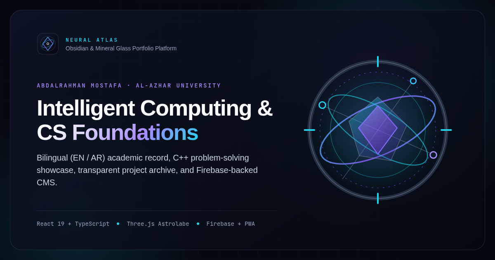
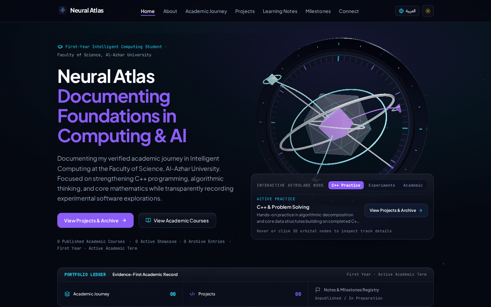
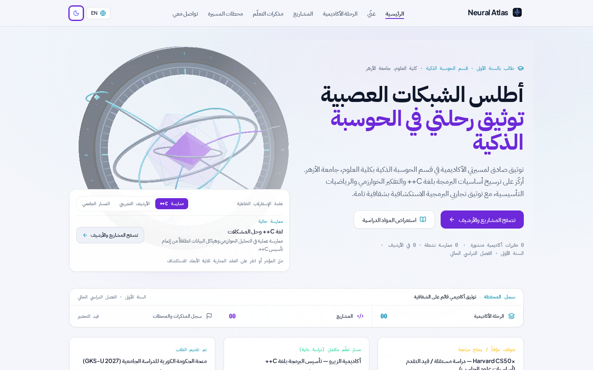
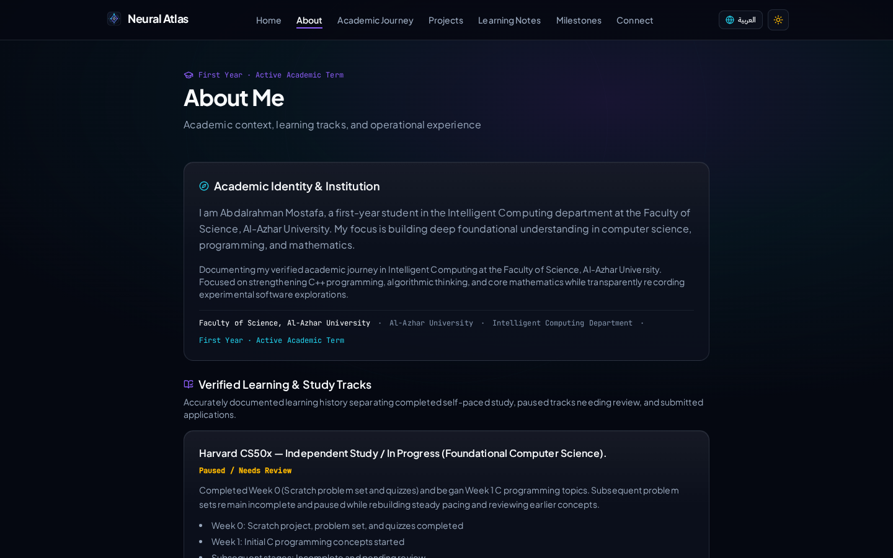

<div align="center">
  

  <br />

  <h1>Neural Atlas</h1>
  <p>
    <strong>Bilingual (EN / AR) Academic Record, Computational Practice Showcase &amp; Firebase-Backed CMS</strong>
  </p>

  <p>
    
    
    
    
    
    
    
    <a href="https://github.com/dahaliztupe-sketch/neural-atlas/actions/workflows/ci.yml"></a>
    <a href="./LICENSE"></a>
  </p>

  <p>
    <a href="https://ais-pre-ahuiyvesdomlkxjzyw7kqw-152637699957.europe-west1.run.app">Live Preview</a>
    ·
    <a href="./docs/ARCHITECTURE.md">Architecture</a>
    ·
    <a href="./docs/DEPLOYMENT.md">Deployment Guide</a>
    ·
    <a href="./SECURITY.md">Security Model</a>
    ·
    <a href="./CHANGELOG.md">Changelog</a>
  </p>
</div>

---

## Overview

**Neural Atlas** is the personal portfolio, academic documentation platform, and fail-closed CMS of **Abdalrahman Mostafa**, a first-year Intelligent Computing student at the Faculty of Science, Al-Azhar University.

The platform is engineered around **evidence-first documentation**:

- **Strict separation of active practice and historical archive**: Main showcase entries (`Neural Atlas`, `J.A.R.V.I.S.`, `C++ & Problem Solving`, and live storefront `WANASBRAND`) are cleanly separated from archived experiments (`LOCAL AI AGENT` explicitly marked `Discontinued / Archived`, `Kalmeron-Two`, `Sanad`, `Ruwadverse`, `SmartLifeAI`).
- **Accurate academic & learning framing**: Preserves first-year Al-Azhar Intelligent Computing subjects cleanly, documents **Harvard CS50x** accurately as **`CS50x: Week 3`** (ongoing independent study, not completed or certified), distinguishes self-paced tracks (**Elzero C++**) from formal certificates, and records **GKS-U 2027** accurately as `Not Accepted`.
- **Personal Knowledge Library & Skills**: Features structured depth-tiered skills (including practical Excel data organization and active Python study, without artificial proficiency percentages), ~age 12 self-learning background, and 8 bilingual first-person Learning Notes across 9 knowledge categories.

---

## Visual Preview

<table>
  <tr>
    <td width="50%">
      
      <p align="center"><sub><strong>Home (EN · Dark)</strong> — Obsidian &amp; Mineral Glass aesthetic with interactive 3D Astrolabe</sub></p>
    </td>
    <td width="50%">
      
      <p align="center"><sub><strong>Home (AR · Light RTL)</strong> — Native RTL layout with <code>IBM Plex Sans Arabic</code> &amp; Mineral Alabaster palette</sub></p>
    </td>
  </tr>
  <tr>
    <td colspan="2">
      
      <p align="center"><sub><strong>About &amp; Learning Tracks</strong> — Academic context, learning tracks, and operational data experience (zero WebGL loaded on inner routes)</sub></p>
    </td>
  </tr>
</table>

---

## Key Capabilities

### Public Experience
- **Full Bilingual EN / AR & RTL / LTR Parity**: Instant language switching (`document.documentElement.dir` & `lang`) paired with `Plus Jakarta Sans`, `IBM Plex Sans Arabic`, and `JetBrains Mono`.
- **Obsidian Dark & Mineral Alabaster Light Themes**: Persisted theme toggle with balanced surface contrast and accessible focus rings.
- **Home-Only Progressive 3D Astrolabe**: A React Three Fiber / Three.js scene (`HeroCanvasScene`) lazy-loaded strictly on desktop Home (`/`) viewports (`>= 768px`) when WebGL is supported and `prefers-reduced-motion` is off. Inner routes, `/admin`, and mobile viewports render zero `<canvas>` elements and download zero Three.js chunks.
- **Markdown + LaTeX Technical Notes**: Custom `marked` + `highlight.js` + `katex` pipeline with escaped-delimiter handling (`\$50`), strict `trust: false` sanitization, and `dir="ltr"` math isolation inside Arabic RTL content.
- **Zero-CLS Image Pipeline & PWA**: Aspect-ratio reserved `OptimizedImage` component with lightbox preview, `vite-plugin-pwa` offline precaching, and route-level SEO (`JSON-LD`, dynamic meta titles/robots, `sitemap.xml`, `robots.txt`).

### Private Admin Studio (`/admin`)
- **Fail-Closed Owner Gate**: Google Sign-In verified against `emailVerified === true` + owner allowlist (`src/lib/adminConfig.ts`), backed server-side by `firestore.rules`.
- **Full CRUD & Publishing Gates**: Manage Projects (`visibility`, `archiveGroup`, `featuredOnHome`, 8 `statusType` states), Academic Courses, Learning Notes, Milestones, Visitor Inbox (`contactMessages`), and Public Profile (`settings/profile` including learning tracks and practical experience).
- **Backup, Diff Preview, Seed & Non-Destructive Sync**: Schema-validated JSON export/import (`backupService.ts` strips private inbox records and rejects unsafe URLs), idempotent initial seeding, and one-click **Sync Verified Baseline Updates** that reconciles baseline projects and learning tracks while preserving existing `createdAt` timestamps and owner-edited notes.

---

## Architecture Overview

```
Browser (React 19 SPA · History API Router)
 ├── Public Routes (/, /about, /academic, /projects, /projects/:slug, /notes, /notes/:slug, /milestones, /connect)
 │    ├── WorldSceneContext + ImmersiveWorldBackground (3D Canvas mounted ONLY on desktop /)
 │    ├── useCachedResource (In-memory + sessionStorage SWR cache + BroadcastChannel sync)
 │    └── contentRepository.ts ──▶ Cloud Firestore (queries require publicationStatus=='published' && visibility=='public')
 │
 └── Private Owner Studio (/admin · Lazy Chunk)
      ├── AuthContext (Google Sign-In popup + email_verified check)
      └── AdminDashboard ──▶ Cloud Firestore (owner-only drafts, internal_archive, settings/profile, contactMessages)
```

For deeper technical details (SWR cache invariants, KaTeX/Markdown security, and 3D software-GL demand-mode settlement), see [docs/ARCHITECTURE.md](./docs/ARCHITECTURE.md).

---

## Technology Stack

| Layer | Technologies |
| :--- | :--- |
| **UI & Styling** | React 19, TypeScript, Tailwind CSS v4 (`@tailwindcss/vite`), Lucide Icons |
| **3D Graphics** | Three.js, `@react-three/fiber` (Home desktop progressive enhancement only) |
| **Content Rendering** | `marked`, `highlight.js`, `katex` |
| **Backend & Auth** | Firebase Authentication (Google Sign-In), Cloud Firestore (Named Database) |
| **Build & PWA** | Vite 8 (`rolldownOptions` chunk splitting), `vite-plugin-pwa` (Workbox) |
| **Testing & Lint** | Node built-in test runner via `tsx --test`, `tsc --noEmit`, `@firebase/eslint-plugin-security-rules` |

---

## Project Structure

```text
.
├── .github/                  # Issue/PR templates, CODEOWNERS, CI workflow, Dependabot, social preview
├── docs/                     # Architecture, deployment, security spec, live screenshots, historical archive
├── public/                   # Static icons, PWA icons, robots.txt, sitemap.xml, og-preview.png
├── scripts/                  # GitHub verification & push helper (sync-github.sh)
├── src/
│   ├── components/           # Shared UI, Markdown/KaTeX renderer, OptimizedImage, world/ (3D Astrolabe)
│   ├── context/              # AppContext (theme/language/SEO/profile) & AuthContext (Firebase Auth)
│   ├── data/                 # Verified baseline datasets & bilingual UI translations
│   ├── hooks/                # Cached SWR hook, focus trap, online status, PWA install prompt
│   ├── lib/                  # Firebase init, validation, sanitization, Markdown/KaTeX, SEO, error boundary
│   ├── pages/                # Public pages & private Admin Studio (/pages/admin/*)
│   ├── router/               # Lightweight History API router & tests
│   ├── services/             # Firestore repository, client SWR cache, JSON backup/diff service
│   └── types/                # Shared domain models & union types
├── firebase-blueprint.json   # Canonical JSON Schema for all 6 Firestore collections
├── firestore.rules           # Server-side Firestore Security Rules
├── firestore.indexes.json    # Required Firestore composite indexes
├── firestore.rules.test.ts   # Rules-blueprint parity & adversarial payload test suite
├── vercel.json               # Vercel SPA rewrites, PWA cache headers & popup-safe COOP headers
├── vite.config.ts            # Vite + PWA + SEO build plugin + vendor chunk splitting
├── package-lock.json         # Deterministic npm lockfile for CI & Vercel builds
└── package.json              # Scripts and dependencies
```

---

## Getting Started

### Prerequisites
- **Node.js** `>= 20` (tested on Node `22.x`)
- **npm** `>= 10`

### Installation & Local Development

```bash
# 1. Clone the repository
git clone https://github.com/dahaliztupe-sketch/neural-atlas.git
cd neural-atlas

# 2. Install dependencies
npm install

# 3. Optional: copy environment template for custom production domain SEO
cp .env.example .env

# 4. Start the development server on http://localhost:3000
npm run dev
```

> **Note on `firebase-applet-config.json`:** Client-side Firebase configuration (`projectId`, `apiKey`, `appId`, `firestoreDatabaseId`) lives in `firebase-applet-config.json`. These are standard public Firebase Web app identifiers, not private secrets; true access control is enforced server-side in `firestore.rules`.

---

## Environment Variables

Defined in [`.env.example`](./.env.example):

| Variable | Purpose | Required |
| :--- | :--- | :---: |
| `VITE_SITE_URL` | Public canonical origin (e.g. `https://neural-atlas.example.com`) used at build time for `sitemap.xml`, `robots.txt`, canonical tags, and OpenGraph image URLs. Falls back cleanly to runtime origin/relative paths if unset. | No |
| `GEMINI_API_KEY` | Runtime environment placeholder provided by the hosting template (not exposed to client code or required by public pages). | No |
| `APP_URL` | Hosting runtime service URL injected in Cloud Run environments. | No |

---

## Available Scripts

| Command | Description |
| :--- | :--- |
| `npm run dev` | Starts Vite development server on port `3000` (`0.0.0.0`) with `/robots.txt` and `/sitemap.xml` dev middleware |
| `npm run build` | Builds the optimized production bundle, PWA service worker, and SEO files into `dist/` |
| `npm run preview` | Serves the compiled `dist/` bundle locally via Vite preview |
| `npm run lint` | Runs TypeScript static type checking (`tsc --noEmit`) |
| `npm run lint:rules` | Validates `firestore.rules` with `@firebase/eslint-plugin-security-rules` |
| `npm test` | Executes the unit, regression, and security-rules test suite across 11 `*.test.ts` files (`80` subtests) |
| `npm run sync:github` | Runs full verification (`lint`, `lint:rules`, `test`, `build`) and pushes changes via `scripts/sync-github.sh` |
| `npm run clean` | Removes the generated `dist/` directory |

---

## Testing & Verification

Run the full local verification suite before opening a pull request:

```bash
npm run lint
npm run lint:rules
npm test
npm run build
```

What is verified automatically in `npm test`:
- **Data Integrity (`src/data/data.test.ts`)**: Enforces zero fabricated course codes/grades, visibility split (`public` vs `internal_archive`), accurate CS50x/GKS-U/WANASBRAND framing, and absence of unverified claims.
- **Validation & Security Rules (`src/lib/validation.test.ts`, `firestore.rules.test.ts`)**: Verifies 100% schema parity between `firebase-blueprint.json` and `firestore.rules`, PII omission on `settings/profile`, URL protocol checks, and adversarial payload rejection.
- **Repository, Cache & Backup (`src/services/*.test.ts`)**: Ensures Firestore query errors never mask permission/network failures, validates baseline sync `createdAt` preservation, validates SWR stale-preservation, and confirms backup exports strip private inbox items.
- **Markdown/KaTeX, SEO, Routing & 3D Capability (`src/lib/*.test.ts`, `src/router/router.test.ts`, `src/components/world/world.test.ts`)**: Tests XSS sanitization, `noindex` on admin/draft routes, route matching, and strict Home-only 3D mounting.

---

## Security Considerations

- **Explicit Error Surfacing & Verified Local Baseline**: When Firestore is configured, query or permission errors surface explicitly instead of masking backend failures, while unseeded empty collections fall back cleanly to verified local baseline records.
- **Explicit Public Visibility Gate**: Public `projects` queries and Firestore rules require both `publicationStatus == 'published'` and `visibility == 'public'`. Legacy documents missing `visibility` and `internal_archive` records are denied to anonymous readers.
- **PII Isolation**: `settings/profile` does not accept `contactEmail`; public `JSON-LD` and JSON backups never include personal email addresses or visitor messages.
- **Hardened Markdown/KaTeX**: Disallows `javascript:`, `vbscript:`, and `data:` protocols and runs KaTeX with `trust: false`.

See [SECURITY.md](./SECURITY.md) and [docs/ADMIN_SETUP.md](./docs/ADMIN_SETUP.md) for full details.

---

## Implementation Status & Roadmap

### Implemented
- Bilingual EN/AR & Dark/Light UI shell across all public routes and `/admin`
- Firestore schema blueprint, security rules (`firestore.rules`), composite index definitions, and unit/rules tests
- Home-only progressive 3D Astrolabe with software-GL demand settlement and WebGL context recovery
- Markdown + KaTeX rendering pipeline, SWR cache, backup export/import diff, and PWA support

### Planned / Owner Operational Steps
- Completing live `/admin` content migration/seeding and reviewing legacy Firestore records (`visibility: 'public'`)
- Configuring Firebase App Check if anti-abuse rate limiting on `/connect` scales up
- Publishing upcoming first-year Learning Notes and verified academic Milestones as coursework progresses

---

## Contributing

Contributions focused on bug fixes, accessibility, performance, documentation clarity, and test coverage are welcome. Please read [CONTRIBUTING.md](./CONTRIBUTING.md) and [CODE_OF_CONDUCT.md](./CODE_OF_CONDUCT.md) before submitting a pull request.

---

## License

- **Application Source Code**: Licensed under the [MIT License](./LICENSE).
- **Personal Portfolio Content**: Personal biographical copy, academic records, study notes, project case-study text, and personal branding assets remain the copyright of **Abdalrahman Mostafa** and may not be republished as your own identity.

---

## Author & Acknowledgments

**Abdalrahman Mostafa** — First-Year Intelligent Computing Student, Faculty of Science, Al-Azhar University  
- GitHub: [@dahaliztupe-sketch](https://github.com/dahaliztupe-sketch)  
- LinkedIn: [Abdalrahman Mostafa](https://www.linkedin.com/in/abdalrahman-mostafa-/)
